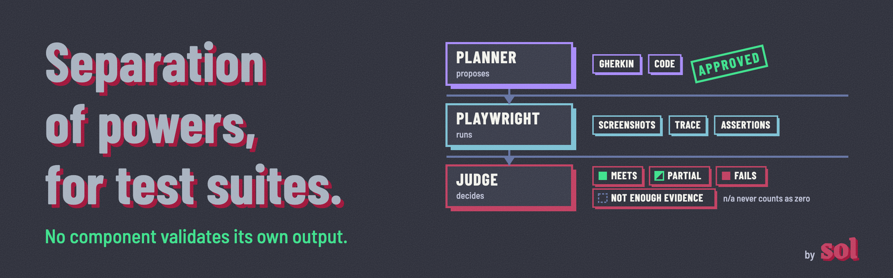
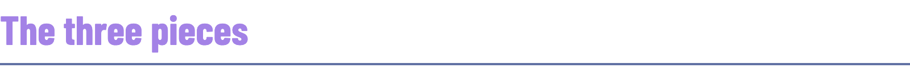
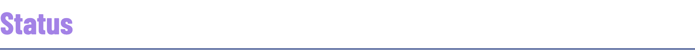

A method for end-to-end testing where an AI agent proposes what to test, a human approves it, Playwright runs it, and a versioned judgment layer decides whether the result is right.

One rule holds it together: **no component validates its own output.** It is enforced at three boundaries. A human fixes what each test has to prove (intent). Approved intent cannot change silently during code generation or execution (execution integrity). The component that proposed or ran a test never issues the verdict (judgment separation).

The runner is not the point. Playwright wrappers are plentiful. The point is the two layers around it: **what gets tested, and how the outcome is judged.**

<h3></h3>

1. **Planning agent.** Reads a change or a requirement and proposes test scenarios, written in Gherkin, for a human to approve.
2. **Playwright execution.** Approved scenarios are translated into Playwright tests in TypeScript, approved again as code with a coverage manifest, and frozen. A selector that breaks is a failing test.
3. **Judgment layer.** Decides whether each outcome passes, against versioned criteria and a versioned judge configuration, with required evidence.

Full description: [METHOD.md](METHOD.md). Why these choices: [DECISIONS.md](DECISIONS.md). 🌐 Resumen en castellano: [README.es.md](README.es.md).

<h3></h3>

- QA and e2e engineers who already use Playwright and want to add an agent without handing it the verdict.
- Teams evaluating agentic testing tools who need a vocabulary to compare them: which generation a tool belongs to, and where its judgment lives.

<h3></h3>

- **Not a generic framework.** It is an opinionated harness, a thin layer that orchestrates and does not reinvent. It is being built against one real application, Ghost, not as a product that competes with existing tools.
- **Not a Gherkin framework.** Gherkin is the agent's output for human review, never the layer where tests are written. See D2 and D3 in [DECISIONS.md](DECISIONS.md).
- **Not self-healing, in v1.** A selector that breaks is a failing test. If self-healing is ever added, it may repair how an element is found and never what a test asserts, with every repair logged.
- **Not a planner grading its own proposal.** The judgment layer is separate from the planning agent. Playwright's pass or fail is evidence for it, not its verdict, and its criteria are versioned.

<h3></h3>

Method v0.2, draft. No harness code yet: it comes next, built against [Ghost](https://github.com/TryGhost/Ghost) and demonstrated on two or three of its real pull requests. The rule itself already runs in [rag-bouncer](https://github.com/missyeahhh/rag-bouncer).

**Related work.** [rag-bouncer](https://github.com/missyeahhh/rag-bouncer): the same rule in running code. An eval gate in CI blocks a quality regression, and a healing guard accepts a repair only if it changes how an element is found, never what a test asserts, which is the boundary decision D6 describes. It is separate from the harness, and it tests a support assistant, not an e2e suite.

[Customer support chatbot observatory](https://github.com/missyeahhh/chatbot-observatory): public audits of support chatbots against three versioned rubrics. Same idea, applied to a different system: measurable criteria, a defined test, required evidence. The judgment layer here borrows its rules from there, and from the observatory's [taxonomy of failures in an agentic system](https://github.com/missyeahhh/chatbot-observatory/blob/main/metodo/taxonomia-de-fallas.md).

<h3></h3>

Building something similar, or think a boundary is in the wrong place? Let me know!

- 🐛 [Open an issue](https://github.com/missyeahhh/agentic-e2e-method/issues): challenge a rule, suggest a case, ask about the method.
- 💬 [Message me on LinkedIn](https://www.linkedin.com/in/soldr): feedback, or how you would use it.

---

🎨 Made by [Soledad De Rosa](https://www.linkedin.com/in/soldr). Built with [Claude Code](https://claude.com/claude-code). [CC BY 4.0](LICENSE): reuse it, citing the source.
